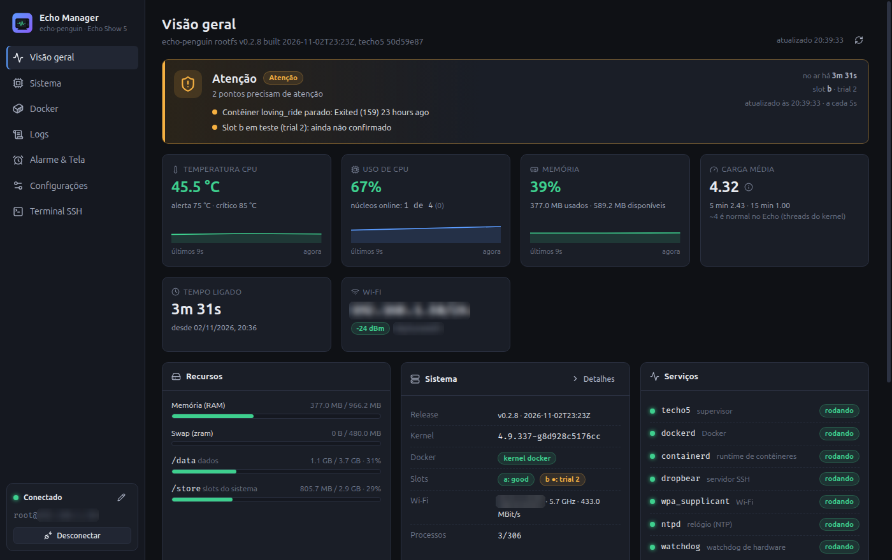
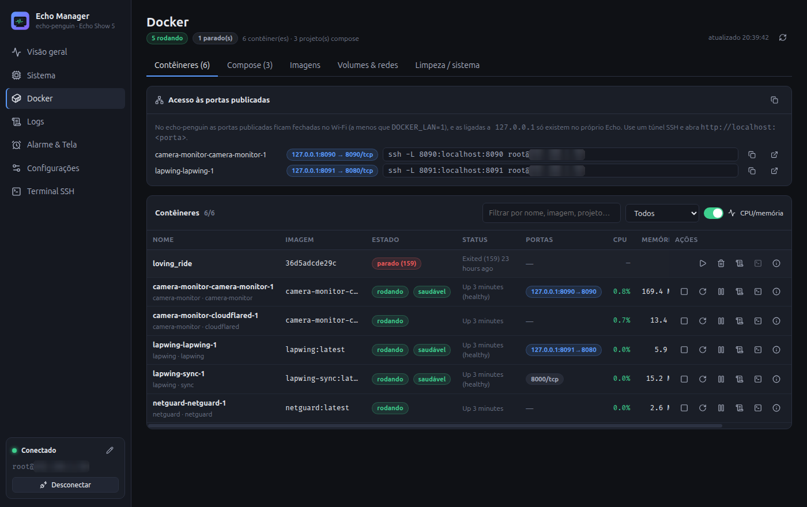
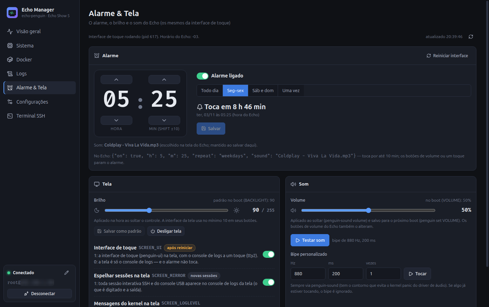
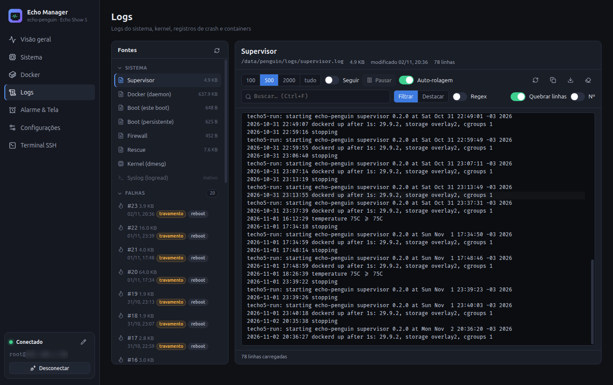
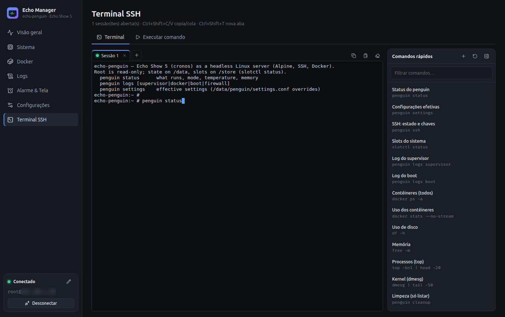

<p align="center">
  
</p>

<h1 align="center">Echo Manager</h1>

<p align="center">
  A friendly desktop app to look after your <b>Echo Show 5</b> running
  <a href="../echo-penguin">echo-penguin</a> (Alpine Linux), right from your computer.
</p>

<p align="center">
  
</p>

---

## What is this?

Your Echo Show 5 is now a tiny Linux server. **Echo Manager** shows you, in one window, how it's doing
and lets you take care of it, with no command line needed. It's like a dashboard for a car, but for your
Echo:

- 💚 **Is it healthy?** Temperature, memory, storage, Wi-Fi and services at a glance, with a clear
  *All good / Needs attention / Critical* message.
- 📦 **Your apps (Docker containers):** see what's running, start, stop or restart them, read their logs.
- 📜 **Logs:** everything the Echo wrote down, live, with search.
- ⏰ **Alarms, screen and sound:** set up to eight alarms (time, repeat, on/off, beep or a song),
  change brightness or let it follow the room's light, set the volume, play a test beep.
- 🌅 **Waking up and sleeping:** a "sunrise" on the screen before the alarm, an alarm that starts
  quietly, a dim night clock, the weather for your city, a voice that says the time and the
  weather after the alarm, and a sleep diary of the last two weeks.
- ⚙️ **Settings and maintenance:** every echo-penguin setting explained, who may connect over SSH,
  firewall ports, safe restarts and updates.
- 💻 **Terminal:** for when you *do* want the command line, with handy saved commands.

Echo Manager talks **only to your Echo**, over SSH, on your home network. It doesn't install anything on
the Echo and doesn't send anything to the internet. (The weather comes from the Echo itself: when you
search for your city, it's the Echo that asks [Open-Meteo](https://open-meteo.com), as its screen does.)

> The app's screens are in Brazilian Portuguese. This guide is in English.

<p align="center">
  
  
  
  
</p>

---

## What you need

- ✅ An **Echo Show 5 (2nd gen)** already running **echo-penguin**, connected to your Wi-Fi.
- ✅ A computer with **Linux Mint 22** (Ubuntu 24.04 and similar work too), on the **same Wi-Fi**.
- ✅ The **SSH key** you used when you installed echo-penguin (usually `~/.ssh/techo5`).
- ✅ The Echo's **IP address**. On the Echo's screen, tap **Network & SSH**: it's shown there
  (something like `192.168.1.50`).

---

## Install, step by step

Pick **one** of the three ways below. If you're not sure, use **Option A**.

### Option A: the installer package (`.deb`), easiest

1. Get the file **`echo-data-viewer_0.3.1_amd64.deb`**. Someone may have given it to you, or you can
   build it yourself (see [Option C](#option-c-build-it-yourself)). It ends up in the `release/` folder.
2. **Double-click** the file. The Software Installer opens.
3. Click **Install** and type your computer password when asked.
4. Done! Open the **Menu**, search for **Echo Manager**, and click it.

Prefer the terminal? This does the same thing:

```bash
sudo apt install ./release/echo-data-viewer_0.3.1_amd64.deb
```

### Option B: the portable app (`.AppImage`), no install

1. Get the file **`EchoManager-0.3.1-x86_64.AppImage`**.
2. Right-click it → **Properties** → **Permissions** → tick **Allow executing file as program**.
3. Double-click it. That's it.

Want it in the Menu too? From the project folder run:

```bash
npm run install-desktop
```

It copies the app to `~/.local/bin` and adds **Echo Manager** to your Menu (no password needed).

### Option C: build it yourself

You only need to do steps 1–2 once.

1. **Install Node.js 22** (the version in Mint's Software Manager is too old). The simplest way is *nvm*:

   ```bash
   curl -o- https://raw.githubusercontent.com/nvm-sh/nvm/v0.40.3/install.sh | bash
   # close the terminal, open a new one, then:
   nvm install 22
   ```

2. **Get the code** and install its parts:

   ```bash
   git clone https://github.com/matheusinfo/echo-penguin-manager.git
   cd echo-penguin-manager
   npm install
   ```

3. **Build the installers:**

   ```bash
   npm run dist
   ```

   After a minute or two you'll find both files in the `release/` folder. Now follow
   [Option A](#option-a-the-installer-package-deb-easiest) or [Option B](#option-b-the-portable-app-appimage-no-install).

---

## First time you open it

1. **Echo Manager looks for your Echo by itself.** If your `~/.ssh/config` has a `Host echo` entry
   (the echo-penguin install guide suggests one), it's already filled in and connects straight away.
2. **Otherwise a welcome window opens.** Fill in:
   - **Endereço** (address): the Echo's IP from its **Network & SSH** screen.
   - **Chave privada** (private key): your SSH key, usually `~/.ssh/techo5`. Click the 📁 button to pick it.
   - **Senha da chave** (key password): only if your key has one **and** Linux Mint hasn't unlocked
     it for you already. Usually you can leave it empty.
3. Click **Salvar e conectar** (save and connect). The dot at the bottom-left turns **green:
   Conectado** (connected). 🎉

You can change any of this later with the ✏️ pencil next to the connection status.

> **Tip:** if the Echo restarts or the Wi-Fi drops, Echo Manager reconnects on its own and tells you
> with a notification.

---

## A quick tour

| Menu item | What you'll find |
|---|---|
| **Visão geral** (Overview) | The big picture: a health message with the reasons, temperature, CPU, memory, storage, Wi-Fi, services, your containers, the next alarm due (and the weather and last night's sleep) and recent problems. Small charts show the last few minutes. |
| **Sistema** (System) | All the details: version, the two system slots (A/B), each CPU core, temperatures, running programs, network and firewall, installed packages, kernel messages. |
| **Docker** | Your containers: start, stop, restart, pause, remove, live logs, details, run a command inside. Also compose projects, images, volumes, networks and a cleanup corner. |
| **Logs** | Every log in one place (supervisor, Docker, boot, firewall, kernel, crash records, each container). Turn on **Seguir** (follow) to watch it live; search with the box. |
| **Alarme & Tela** (Alarm & Screen) | Add, change and remove alarms (time, repeat, on/off, the beep or one of the songs in `/data/penguin/music`); **Despertar** (waking up): sunrise before the alarm, volume that rises; **Tela noturna**: the dim night clock and its colour; automatic brightness on/off, the bright-room and dark-room levels and the light sensor's reading; brightness, screen off, volume, test beep; **Clima**: pick your city and see the forecast the Echo has; **Voz**: the voice, speaking after the alarm, the natural (Piper) voice for the alarm, a test; **Sono**: the sleep diary of the last 14 nights. |
| **Configurações** (Settings) | Every echo-penguin setting with an explanation, who may connect over SSH and their keys, firewall ports, and maintenance: restart, reboot, roll back to the previous system, clean up, export a diagnostic report. |
| **Terminal SSH** | A real terminal on the Echo, in tabs, with a list of saved commands you can click. There's also a simple "run one command" box with history. |

### How do I…

- **…add or change an alarm?** *Alarme & Tela* → **Adicionar alarme** (or edit one in the list):
  set the time with the arrows, pick the repeat and the sound → **Salvar**. The Echo's screen picks
  the alarms up by itself within a second. (On echo-penguin v0.2.8 and older there is a single alarm,
  and saving restarts the screen's interface for a second, resetting a running timer or stopwatch.)
- **…make the screen dimmer when the room is dark?** *Alarme & Tela* → *Tela* → turn on **Brilho
  automático** and set **Ambiente escuro** lower. If it stays bright with the lights off, click
  **Está escuro agora** while the room is dark (needs echo-penguin v0.2.9 or newer).
- **…wake up more gently?** *Alarme & Tela* → *Despertar*: the **sunrise** (the screen brightens
  before the alarm) and the **volume gradual**: the alarm starts at a percentage of its volume (80 % by
  default, so 40 when the volume is 50) and rises to it; 100 % means no ramp. Needs echo-penguin v0.3.0
  or newer.
- **…get the weather on the Echo?** *Alarme & Tela* → *Clima* → type your city → **Buscar** → **Usar**
  next to the right one. The Echo fetches the forecast right away and every 30 minutes, shows it under
  its clock and says it after the alarm. **Remover** turns the weather off.
- **…hear the time and the weather after the alarm, in Portuguese?** *Alarme & Tela* → *Voz* → pick
  **Português (Brasil)** and turn on **Falar depois do alarme**; **Testar voz** plays it now.
- **…have the alarm greet me with a natural voice?** *Alarme & Tela* → *Voz* → **Voz do despertador** →
  **Piper (natural)**, pick the **Voz natural** (the image has `pt_BR-faber-medium`; extra Piper voices go
  in `/data/penguin/voices` as `.onnx` + `.onnx.json`) and **Testar voz natural** (it takes about 40 s
  before it speaks). Piper is offline but slow on the Echo, so the greeting is prepared about 10 minutes
  before the alarm; tapping the clock still uses the instant espeak voice. Needs echo-penguin v0.3.1 or
  newer.
- **…see how I slept?** *Alarme & Tela* → *Sono*: each night as a bar from lights off to waking up,
  with the times, the duration and the 7-night average. The diary works from the room's
  light: if nights don't show up, click **Está escuro agora** with the light off.
- **…restart one of my apps?** *Docker* → find it in the list → click the ↻ restart button.
- **…see why something failed?** *Logs* → pick it on the left → type a word in the search box.
- **…restart the Echo?** *Configurações* → *Manutenção* → **Reiniciar** (reboot). The app reconnects
  by itself when the Echo is back, usually within a minute.

Anything that could cause trouble (rebooting, turning SSH off, removing a container…) always asks
**"Are you sure?"** first and explains what will happen.

---

## Safety and privacy

Echo Manager was built to be safe to leave open:

- 🏠 **Local only.** It only connects to the Echo address you entered. No accounts, no cloud, no
  tracking.
- 🔑 **Your key stays yours.** It uses the key already on your computer (through Linux Mint's keyring
  when available). If you type a key password, it's stored **encrypted in the system keyring**, never in
  plain text, and kept only in memory if there's no keyring.
- 🛡️ **It checks it's really your Echo.** The first time it connects, it remembers the Echo's identity
  (and double-checks it against `~/.ssh/known_hosts`). If a different device ever answers at that
  address, Echo Manager refuses to connect and tells you. *Reinstalled your Echo?* Open the ✏️
  connection window and click **Esquecer identidade** (forget identity).
- 🧯 **Careful with the Echo.** At most four commands run at the same time, polling is light and pauses
  when the window is minimized, and anything it starts (like following a log) is stopped on the Echo when
  you're done.
- 🔒 **Locked-down app.** The window can't open other websites or ask for camera/microphone; links open
  in your normal browser.

Echo Manager logs in as the Echo's administrator (`root`), like the echo-penguin guide does, so treat the
computer it runs on as you would the Echo's key itself.

---

## Something's not working?

| You see | Try this |
|---|---|
| *"O Echo não respondeu"* (didn't answer) | Is the Echo on and on the same Wi-Fi? Check its IP on **Network & SSH** and update it with ✏️. |
| *"recusou a conexão"* (refused) | SSH may be turned off on the Echo: on its screen go to **Network & SSH** and turn SSH on. |
| *"não aceitou a chave"* (key not accepted) | Pick the right key with ✏️. If the Echo only allows some computers, on its screen tap **Network & SSH → Allow any device**, then connect again. |
| *"A identidade do Echo mudou"* (identity changed) | Did you reinstall echo-penguin? Then ✏️ → **Esquecer identidade**. If not, don't connect and check your network. |
| It connects, then waits a while after many attempts | The Echo's firewall allows only a few new connections per minute. Wait a minute; the app retries by itself. |
| The app doesn't open from the AppImage | Make sure "Allow executing file as program" is ticked (Option B, step 2). |

Still stuck? *Configurações → Manutenção → Exportar diagnóstico* saves a report you can share with
whoever helps you.

---

## Uninstall

- Installed with the `.deb`: `sudo apt remove echo-data-viewer`
- Installed with `npm run install-desktop`:
  `rm ~/.local/bin/EchoManager.AppImage ~/.local/share/applications/echo-manager.desktop`
- Your settings live in `~/.config/Echo Manager/`; delete that folder to start fresh.

---

## For developers

```bash
npm install          # ssh2's optional native add-ons are skipped on purpose: the pure-JS code is used
npm run dev          # Vite + Electron with hot reload
npm run typecheck
npm run dist         # release/*.AppImage and release/*.deb
```

How it's built: **Electron** + **React** + **TypeScript** + **Vite**. A single SSH connection
([ssh2](https://github.com/mscdex/ssh2)) carries every command, live stream and terminal (xterm.js).

```
electron/main.js       window, IPC (every call checked), config, keyring, notifications
electron/ssh.js        the SSH connection: commands (max 4 at once), live streams, terminals
electron/hostkeys.js   Echo identity check (pinning + ~/.ssh/known_hosts)
electron/preload.js    the small, safe bridge the page uses (window.echo)
src/api.ts             typed bridge + helpers (shq quoting, runSections batches many reads in one command)
src/hooks.ts           shared React hooks: polling, live streams, saved values, actions
src/components/        shared UI pieces and the connection window
src/pages/             one folder/file per screen
```

Rules of the house: every value put into a shell command goes through `shq()` or is strictly
validated; anything destructive asks for confirmation; polling uses one SSH command per refresh.

## License

MIT. See [LICENSE](LICENSE). Not affiliated with or endorsed by Amazon.
